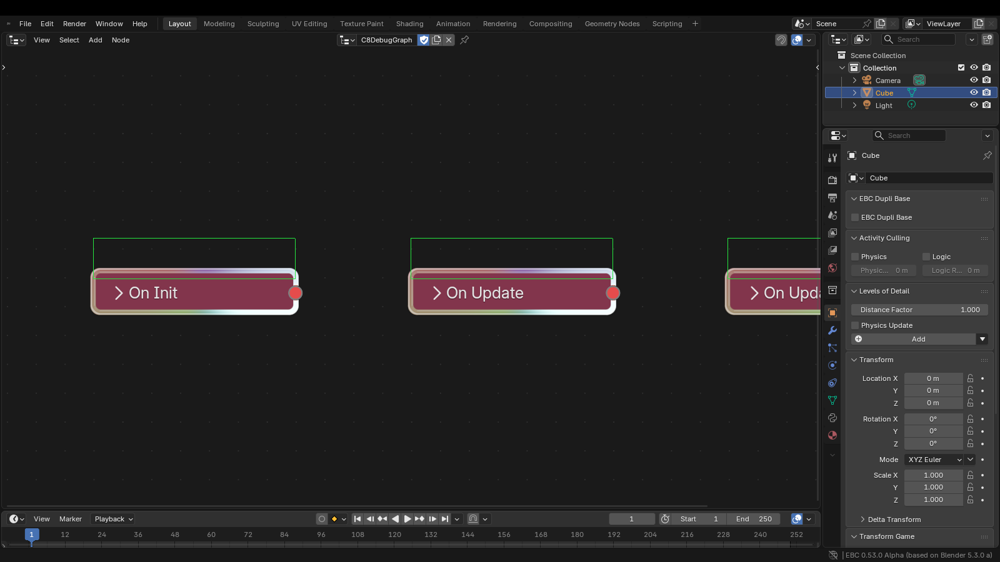

# 真机 / 真实 display 验证清单（D.4）

本文件记录只能在真实 GUI 环境里成立、headless 无法证明的验收项。

状态只允许三种：

- `verified`：已在真实 display 上按本文方法完成验证，有截图/日志/退出码等证据；
- `pending real device`：尚未在真实 display 上验证，不得写成 verified；
- `blocked（原因）`：尝试过但被环境或依赖阻塞。

## 状态总览

| # | 验证项 | 状态 |
|---|--------|------|
| 1 | 触摸输入（多点、拖拽） | `pending real device` |
| 2 | 手柄输入（轴/按钮映射） | `pending real device` |
| 3 | 3D 音效（定位、衰减、遮挡） | `pending real device` |
| 4 | 热重载绿框 | `verified` |
| 5 | 鼠标拖拽连线（含缩放后命中精度） | `pending real device` |
| 6 | 载具（四轮挂载、转向、悬挂） | `pending real device` |
| 7 | 导航（Detour 寻路可用性） | `pending real device` |
| 8 | 骨骼动画（播放、混合、SetBoneTransform 延迟） | `pending real device` |

---

## 1. 触摸输入（多点、拖拽）

**验证方法**：在有触摸屏的真实设备上启动 `blenderplayer`，用系统级触摸注入
（或直接手指）依次验证：单指按下/拖动、双指同时按下、双指拖拽、触摸离开后
事件不再残留。观察对象是否随手指移动、多点是否互斥、UI 的
`HitTestPoint` 是否命中正确元素。

**所需环境**：带触摸屏的真实设备或支持多点触摸的 X/Wayland 注入工具；
`build_linux/bin/blenderplayer`；一个带可拖拽 UI 元素和触摸监听节点的测试场景。

**预计耗时**：0.5 天。

**当前状态**：`pending real device`。现有环境只有鼠标/键盘事件，无法证明多点与
拖拽语义。

## 2. 手柄输入（至少一个常见手柄的轴/按钮映射）

**验证方法**：接入一个常见手柄（Xbox / DualShock 类型），在 `blenderplayer`
里读取 `JoystickAxis` / `JoystickButton` 节点输出，逐一核对左/右摇杆轴的正负
方向、扳机轴范围、A/B/X/Y 与肩键映射；再验证摇杆死区与连续推杆的稳定性。

**所需环境**：真实手柄 + 可用的 SDL/udev 输入设备；`blenderplayer`；含
`JoystickAxis` / `JoystickButton` 节点的测试场景；能把轴值打印到日志或屏幕。

**预计耗时**：0.5 天（不含手柄型号适配）。

**当前状态**：`pending real device`。未接入物理手柄，轴映射与符号约定未验证。

## 3. 3D 音效（听感定位、衰减、遮挡）

**验证方法**：在真实声卡/耳机上放置一个可移动声源与听者，验证：
左右/前后定位是否与几何一致；距离衰减是否符合设定；在声源与听者之间加遮挡物
后音量/滤波是否变化；多声源同时播放是否串扰。

**所需环境**：真实声卡与耳机/音箱（不能用 headless 音频）；`blenderplayer`；
含 3D 声源、听者与遮挡物的测试场景；可调的衰减/遮挡参数。

**预计耗时**：0.5–1 天（听感判定需要人工试听）。

**当前状态**：`pending real device`。headless 无法验证“听感定位”，只能验证
接口调用不崩溃。

## 4. 热重载绿框（B6.7 Phase C.8）

**状态：`verified`。** 在真实 X display 上可见：`DISPLAY=:0` 的 GNOME 桌面
（1920x1080，不是 Xvfb；本机未安装 Xvfb）。截图显示三个逻辑节点
（`C8_OnInit` / `C8_OnUpdate` / `C8_OnUpdate_B`）外侧各有一圈绿色边框。



**验证方法（可复现）**：

1. 准备场景：`BGELogicTree` 内放 3 个节点（`NLOnInitConditionNode`、
   `NLOnUpdateConditionNode` ×2），节点名设为上述三个名字，挂到
   `Cube.logic_trees`；开启
   `preferences.addons['bge_netlogic'].preferences.use_native_graph_runtime`，
   保存为 `c8_scene/c8_scene.blend`（测试时在运行目录自建，未入库；场景内写入
   `game_graph_manifest`）。
2. 启动 GUI（真实 display）：

   ```bash
   DISPLAY=:0 build_linux/bin/blender -noaudio --factory-startup \
     --window-geometry 0 0 1600 900 \
     c8_scene/c8_scene.blend --python <驱动脚本>.py
   ```

   `<驱动脚本>` 未入库且历史副本已失效，按下面第 3 步的要点重建即可。

3. 驱动脚本：
   - 把最大区域切成 `NODE_EDITOR`。**先设
     `space.tree_type = 'BGELogicTree'` 再设 `space.node_tree`**，否则编辑器
     停留在 `GeometryNodeTree`，赋树会被忽略。
   - 调 `bpy.ops.node.view_all()` 让三个节点入镜。
   - 写 `<blend_dir>/.debug_trace.on` 并调用
     `bge_netlogic.ops.debug_trace._add_handler()`。
   - 用 `subprocess` 启动
     `build_linux/bin/blenderplayer -w 1600 900 0 0 -g noaudio c8_scene.blend`，
     环境变量 `BGE_GAMENODE_DEBUG=1`。
   - 约 3 秒后调用 `bpy.ops.netlogic.hot_reload()`（写
     `.hot_reload_manifest.json` + touch `.hot_reload.flag`），再等 2 秒
     `bpy.ops.screen.screenshot(...)` 截图。
4. 判据：
   - `.debug_trace.json` 在热重载前后持续更新，三个节点都有激活记录；
   - 截图中统计到绿色像素，且人工确认三个节点外框为绿色。

**实测证据**：

- 截图：`docs/images/b67_hot_reload_green_box.png`（整窗另存
  `b67_hot_reload_green_box_full.png`）。
- 像素统计：1600x900 截图中绿色描边像素 1912 个，热重载前后两张一致。
- `.debug_trace.json`：热重载前 `frame=36791`，热重载后 `frame=36909`，
  再采样 `frame=37010`；三个节点均在激活列表中。
- 日志：`/tmp/c8_gui.log`（环境探测、启动命令、stdout/stderr、退出码）。
- 退出码：GUI `0`。player 在“截图完成后的退出路径”曾出现 `-11`，
  与绿框本身无关，见文末“未修复问题”。

**所需环境**：X display（真实或 Xvfb 均可）且有可用 GL 上下文；
`build_linux/bin/blender` 与 `blenderplayer`；`bge_netlogic` 可用；原生图运行时
开启；`.blend` 所在目录可写（`.debug_trace.*` 与 `.hot_reload.*` 走该目录）。

**预计耗时**：首次 0.5 天量级（含环境探测与一次排障）；复现约 10 分钟。

## 5. 鼠标拖拽连线（含缩放后的命中精度）

**验证方法**：在节点编辑器中用鼠标从输出端口拖到输入端口，验证：
能建立连线、拖到空白处能取消、从输入拖到输出也成立；把视图放大/缩小到
50% / 200% / 400% 后重复拖拽，记录“视觉端口位置”与“实际命中位置”的偏差，
确认没有固定像素偏移；拖拽中经过其他节点时不误连。

**所需环境**：真实 display + 鼠标（或可注入精确坐标的指针工具）；
`build_linux/bin/blender`；含足够多节点的 `BGELogicTree`；可做视图缩放。

**预计耗时**：0.5–1 天（含不同缩放级别的重复测试）。

**当前状态**：`pending real device`。headless 只能验证连线数据结构，不能验证
缩放后的屏幕命中精度。

## 6. 载具（四轮挂载、转向、悬挂）

**验证方法**：使用四轮载具场景，验证四个车轮是否都正确挂载到车身、车身与车轮
的相对位置是否稳定；用转向输入观察前轮转角与车身转向是否一致；驶过起伏/台阶
观察悬挂压缩与回弹是否异常（穿地、抖动、翻车）；长时间行驶后轮子是否漂移。

**所需环境**：真实 display + 键鼠/手柄；`blenderplayer`；含四轮载具、地面、
坡道/台阶的测试场景；可观察车轮与车身状态（画面或调试日志）。

**预计耗时**：1–2 天（含场景搭建与多轮驾驶观察）。

**当前状态**：`pending real device`。headless 无法证明挂载稳定性与悬挂手感。

## 7. 导航（Detour 寻路可用性，明确无 agent 尺寸）

**验证方法**：在带 NavMesh 的场景里让 agent 从 A 点寻路到 B 点，验证：
能生成路径、能绕开静态障碍、目标不可达时有明确失败结果、路径点可被消费；
再用窄门/窄通道测试，记录“无 agent 半径/高度”带来的穿墙或卡住现象。
**本项明确不包含 agent 尺寸（半径/高度）支持**：当前实现没有 agent 尺寸参数，
验证只覆盖“有没有路、路是否连通”，不把贴身避障算作通过。

**所需环境**：真实 display（或可交互的 player）；`blenderplayer`；烘焙好
NavMesh 的场景；至少一个起点、一个终点和一个静态障碍；窄通道用例。

**预计耗时**：0.5 天。

**当前状态**：`pending real device`。已知限制：无 agent 尺寸，细窄通道与贴墙
行为不作为验收通过条件。

## 8. 骨骼动画（播放、混合、SetBoneTransform 的延迟语义）

**验证方法**：播放一段骨骼动画，确认关节按预期运动；让两段动画在同一骨架上层
叠加，观察混合权重与上下层关系；对同一骨骼连续调用 `SetBoneTransform`，
记录“设置当帧”与“下一帧/渲染帧”生效的差异，确认延迟语义与文档一致；
在动画播放中覆盖骨骼变换，确认覆盖不会被动画下一帧立刻冲掉。

**所需环境**：真实 display；`blenderplayer`；含骨骼动画、至少两段可混合动作的
角色场景；可打印骨骼矩阵/帧号或逐帧截图的调试手段。

**预计耗时**：1 天（含混合与延迟语义的逐帧核对）。

**当前状态**：`pending real device`。headless 无法证明逐帧可见的混合结果与
`SetBoneTransform` 的实际生效时机。

---

## 附：本轮真机验证中已修复的问题

1. **无 3D 视口布局保存后，独立 `blenderplayer` 启动即 SIGSEGV。**
   崩溃地址 `blenderplayer+0x246b255`（objdump 定位到
   `GPG_ghost.cpp` 的 `GetShadingTypeRuntime()`：`CTX_wm_view3d()` 返回
   null 后读取 `+0x118`）。修复：player 启动时若屏幕布局没有 3D 视口，
   把最大的区域切成 `SPACE_VIEW3D` 并重新初始化上下文；无法恢复时
   `GetShadingTypeRuntime()` 返回 `OB_RENDER`，其余 `CTX_wm_view3d()` /
   `CTX_wm_region_view3d()` 解引用点加空指针守卫，渲染矩阵回退到相机矩阵。
   双向验证见 `/tmp/c8_gui_fix.log`：无 3D 视口场景可正常启动、连续跑帧
   （>500 帧）并通过 `Quit Game` 节点以退出码 `0` 结束；有 3D 视口的正常布局
   行为不变（连续跑帧、退出码 `0`）。
2. **打开含逻辑节点的 `.blend` 打印
   `'Node' object has no attribute 'update'`**（`editor/nodetree.py:116`）。
   修复：`BGELogicTree.update` 对每个节点使用 `getattr(n, 'update', None)`，
   未知节点类型（纯 `bpy.types.Node`）跳过。验证：以 GUI 打开
   `c8_scene/c8_scene.blend` 两次，日志中不再出现该错误。

## 未修复问题（仅记录）

1. **player 在完成窗口截图后以 `-11` 退出。** 热重载与绿色边框在退出前均正常。
   常规退出路径（无截图）已验证为退出码 `0`，因此判定该 `-11` 与截图调用后的
   关闭顺序有关，属于独立问题，本轮不改动。
2. 截图是 Blender 窗口内截图，不是物理显示器拍照；绿框可见性由像素统计 +
   截图人工确认双重证据支撑。
