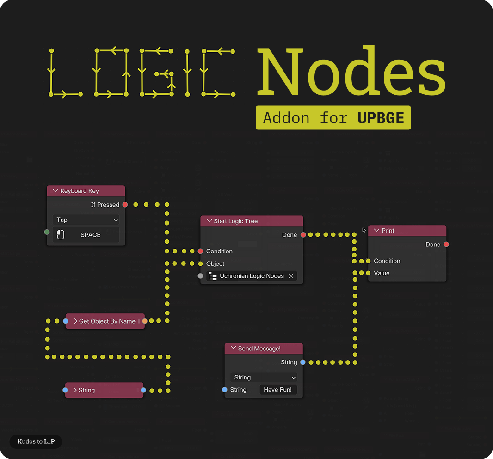

# Uchronian Logic: UPBGE Game Nodes
A Node-based Logic system for UPBGE 0.3.0+ (Blender 2.8+) and UPBGE 0.2.4+ (Blender 2.79b)

This is an Add-On for the recent UPBGE-EEVEE build.
It adds a new Editor in which you can create game logic trees for objects.

## Installation

1. Download
    * Download here: https://github.com/IzaZed/Uchronian-Logic-UPBGE-Logic-Nodes/releases
    * OR clone this repository in a folder named `bge_gamenodes` and then zip it whenever you pull
2. Install
    * In UPBGE, go to **Edit** -> **Preferences** -> **Add-ons** -> **Add-ons Settings** (Drop down arrow in top right corner) and click on **Install from Disk...**
    * Select the downloaded or zipped `bge_gamenodes.zip` file
3. Load
    * Once loaded, activate the Add-On by clicking on the checkbox to the left
  
## Update

1. In **Preferences**, navigate to **Add-Ons** and deactivate, then remove the Add-On
2. Download new version or pull and zip
3. Install
    
## How to use

1. In the Editor Selection, go to **Node Editor**, then set the tree type selector in the header to **Game Nodes**
2. Select an object in the 3D-Viewport: the editor automatically shows that object's Game Nodes tree and keeps following the active object. Pin the editor to keep one tree visible while selecting other objects
3. If the object has no tree yet, the editor shows the empty state panel (**该对象还没有 Game Nodes 树**). Click **New** (or search **F3** for `game_nodes.new_logic_tree`); **New** binds the new tree to the active object only
4. To attach an existing tree to other objects, search **F3** for `game_nodes.apply_logic_tree`, which keeps the multi-selection behaviour (it applies the tree to every selected object). The old **Apply To Selected** panel (**Dashboard** / **Administration**) no longer exists

# Discord Server

https://discord.gg/6xmPJ7ZZ69

# If you want to support this project

head over to https://www.patreon.com/iza_zed

🎉 Thanks to all who use and support this!